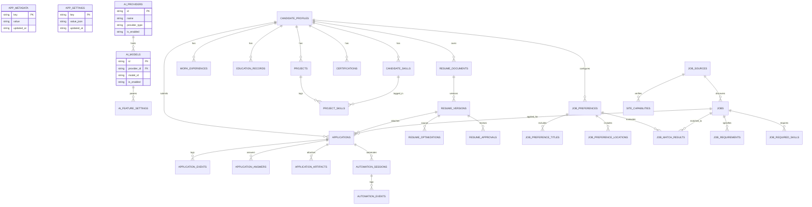

# ApplyPilot — Database Schema & Data Architecture Specification

## 1. Overview & Architecture

ApplyPilot uses **SQLite** for structured transactional domain metadata and the **local filesystem** under a single configurable data root for documents and binary artifacts.

### Key Architectural Tenets
- **Local & Private**: All data is stored strictly on the user's computer. No telemetry, cloud databases, or remote servers.
- **Zero In-Database Secrets**: API keys, passwords, and session tokens are strictly prohibited from SQLite storage and logs.
- **Durable Versioning**: Resumes and documents are never overwritten. Every mutation produces an immutable version record.
- **Single Data-Root Containment**: All user files are contained within a dedicated user directory. Relative paths are validated to prevent directory traversal.

---

## 2. Single Data-Root Resolution Strategy

### Directory Hierarchy
```text
ApplyPilot Data Root/
├── database/
│   └── applypilot.sqlite          # Primary SQLite WAL database
├── resumes/
│   ├── originals/                 # Immutable uploaded PDF & DOCX resumes
│   ├── optimized/                 # AI-enhanced resume outputs
│   └── tailored/                  # Job-specific tailored resumes
├── documents/                     # Other candidate documents (e.g. cover letters)
├── exports/                       # Data transfer exports
├── backups/                       # Local database & file backups
└── logs/                          # Local diagnostic logs
```

### Resolution Order on Windows
1. **Environment Override**: `process.env.APPLYPILOT_DATA_ROOT` if set.
2. **Portable Storage Mode**: A sibling `data/` directory adjacent to the executable (`process.execPath`) if it exists and is writable.
3. **Standard Windows User Data**: Electron's `app.getPath('userData')` (e.g. `C:\Users\<User>\AppData\Roaming\ApplyPilot`).
4. **Development Fallback**: `./.applypilot-data` in the application working directory.

### Path Security Rules
- Filesystem storage stores paths relative to the data root (e.g., `resumes/originals/<id>.pdf`).
- Before any file read or write, `resolveAndValidatePath()` computes `path.relative(root, resolved)`. If the path starts with `..` or is absolute, a security violation is thrown.
- File names are validated against `/^[a-zA-Z0-9_\-\.]+$/` preventing path separator injection.

---

## 3. Schema Migrations & Integrity

Migrations are applied sequentially and tracked in `schema_migrations`.

| Version | Name | Checksum Type | Scope |
|---|---|---|---|
| **1** | `core_metadata_and_ai_configuration` | SHA-256 | `schema_migrations`, `app_metadata`, `app_settings`, `ai_providers`, `ai_models`, `ai_feature_settings` |
| **2** | `candidate_profile_and_history` | SHA-256 | `candidate_profiles`, `candidate_skills`, `work_experiences`, `education_records`, `projects`, `certifications`, `project_skills` |
| **3** | `resume_documents_and_versioning` | SHA-256 | `resume_documents`, `resume_versions`, `resume_optimizations`, `resume_approvals` (+ legacy `resumes` migration) |
| **4** | `job_sources_and_preferences` | SHA-256 | `job_sources`, `job_preferences`, `job_preference_titles`, `job_preference_locations` |
| **5** | `jobs_and_matching_records` | SHA-256 | `jobs`, `job_requirements`, `job_required_skills`, `job_match_results` |
| **6** | `applications_and_submission_history`| SHA-256 | `applications`, `application_events`, `application_answers`, `application_artifacts` |
| **7** | `browser_automation_and_diagnostics` | SHA-256 | `automation_sessions`, `automation_events`, `site_capabilities`, `data_transfers`, `diagnostic_events` |
| **8** | `required_performance_and_constraint_indexes` | SHA-256 | 21 foreign-key, uniqueness, and lookup indexes |

### Migration Rules
- Each migration executes within an isolated `BEGIN IMMEDIATE TRANSACTION` ... `COMMIT` block.
- If a migration fails, it is automatically rolled back via `ROLLBACK` and never recorded in `schema_migrations`.
- Tampering with previously applied migrations triggers a checksum verification mismatch error.

---

## 4. Entity Relationship Diagram (ERD)



---

## 5. Complete Table Inventory & Column Specifications

### 5.1 Application Metadata & Configuration
1. **`app_metadata`**
   - `key` (TEXT, PK, NOT NULL)
   - `value` (TEXT, NOT NULL)
   - `updated_at` (TEXT, NOT NULL)
2. **`schema_migrations`**
   - `version` (INTEGER, PK, NOT NULL)
   - `migration_name` (TEXT, NOT NULL)
   - `checksum` (TEXT)
   - `applied_at` (TEXT, NOT NULL)
3. **`app_settings`**
   - `key` (TEXT, PK, NOT NULL)
   - `value_json` (TEXT, NOT NULL)
   - `updated_at` (TEXT, NOT NULL)
4. **`ai_providers`**
   - `id` (TEXT, PK, NOT NULL)
   - `name` (TEXT, NOT NULL)
   - `provider_type` (TEXT, NOT NULL)
   - `base_url` (TEXT)
   - `auth_type` (TEXT, NOT NULL, DEFAULT `'api_key'`)
   - `credential_reference` (TEXT)
   - `is_enabled` (INTEGER, NOT NULL, DEFAULT 0, CHECK IN `(0, 1)`)
   - `configuration_json` (TEXT, NOT NULL, DEFAULT `'{}'`)
   - `created_at` (TEXT, NOT NULL)
   - `updated_at` (TEXT, NOT NULL)
5. **`ai_models`**
   - `id` (TEXT, PK, NOT NULL)
   - `provider_id` (TEXT, NOT NULL, FK `ai_providers(id) ON DELETE RESTRICT`)
   - `model_id` (TEXT, NOT NULL)
   - `display_name` (TEXT)
   - `capabilities_json` (TEXT, NOT NULL, DEFAULT `'[]'`)
   - `model_configuration_json` (TEXT, NOT NULL, DEFAULT `'{}'`)
   - `is_enabled` (INTEGER, NOT NULL, DEFAULT 1, CHECK IN `(0, 1)`)
   - `created_at` (TEXT, NOT NULL)
   - `updated_at` (TEXT, NOT NULL)
   - Constraint: `UNIQUE(provider_id, model_id)`
6. **`ai_feature_settings`**
   - `id` (TEXT, PK, NOT NULL)
   - `feature_key` (TEXT, NOT NULL, UNIQUE)
   - `model_id` (TEXT, FK `ai_models(id) ON DELETE RESTRICT`)
   - `is_enabled` (INTEGER, NOT NULL, DEFAULT 0, CHECK IN `(0, 1)`)
   - `configuration_json` (TEXT, NOT NULL, DEFAULT `'{}'`)
   - `created_at` (TEXT, NOT NULL)
   - `updated_at` (TEXT, NOT NULL)

### 5.2 Candidate Profile
7. **`candidate_profiles`**
   - `id` (TEXT, PK, NOT NULL)
   - `full_name` (TEXT, NOT NULL)
   - `email`, `phone`, `location`, `country_code`, `linkedin_url`, `portfolio_url`, `github_url` (TEXT)
   - `professional_summary`, `current_title` (TEXT)
   - `total_experience_months` (INTEGER, CHECK `>= 0`)
   - `profile_data_json` (TEXT, NOT NULL, DEFAULT `'{}'`)
   - `created_at`, `updated_at` (TEXT, NOT NULL)
8. **`candidate_skills`**
   - `id` (TEXT, PK, NOT NULL)
   - `profile_id` (TEXT, NOT NULL, FK `candidate_profiles(id) ON DELETE CASCADE`)
   - `name`, `normalized_name` (TEXT, NOT NULL)
   - `category`, `proficiency_level` (TEXT)
   - `years_used` (REAL, CHECK `>= 0`)
   - `source_type` (TEXT, NOT NULL, DEFAULT `'user'`)
   - `created_at`, `updated_at` (TEXT, NOT NULL)
   - Constraint: `UNIQUE(profile_id, normalized_name)`
9. **`work_experiences`**
   - `id` (TEXT, PK, NOT NULL)
   - `profile_id` (TEXT, NOT NULL, FK `candidate_profiles(id) ON DELETE CASCADE`)
   - `company_name`, `job_title`, `start_date` (TEXT, NOT NULL)
   - `employment_type`, `location`, `end_date`, `description` (TEXT)
   - `is_current` (INTEGER, NOT NULL, DEFAULT 0, CHECK IN `(0, 1)`)
   - `achievements_json` (TEXT, NOT NULL, DEFAULT `'[]'`)
   - `created_at`, `updated_at` (TEXT, NOT NULL)
   - Checks: `end_date >= start_date`, `NOT (is_current = 1 AND end_date IS NOT NULL)`
10. **`education_records`**
    - `id` (TEXT, PK, NOT NULL)
    - `profile_id` (TEXT, NOT NULL, FK `candidate_profiles(id) ON DELETE CASCADE`)
    - `institution` (TEXT, NOT NULL)
    - `degree`, `field_of_study`, `location`, `start_date`, `end_date`, `grade`, `description` (TEXT)
    - `created_at`, `updated_at` (TEXT, NOT NULL)
    - Check: `end_date >= start_date`
11. **`projects`**
    - `id` (TEXT, PK, NOT NULL)
    - `profile_id` (TEXT, NOT NULL, FK `candidate_profiles(id) ON DELETE CASCADE`)
    - `name` (TEXT, NOT NULL)
    - `description`, `project_url`, `repository_url`, `start_date`, `end_date` (TEXT)
    - `technologies_json`, `achievements_json` (TEXT, NOT NULL, DEFAULT `'[]'`)
    - `created_at`, `updated_at` (TEXT, NOT NULL)
    - Check: `end_date >= start_date`
12. **`certifications`**
    - `id` (TEXT, PK, NOT NULL)
    - `profile_id` (TEXT, NOT NULL, FK `candidate_profiles(id) ON DELETE CASCADE`)
    - `name` (TEXT, NOT NULL)
    - `issuer`, `credential_id`, `credential_url`, `issue_date`, `expiry_date` (TEXT)
    - `created_at`, `updated_at` (TEXT, NOT NULL)
    - Check: `expiry_date >= issue_date`
13. **`project_skills`**
    - `project_id` (TEXT, NOT NULL, FK `projects(id) ON DELETE CASCADE`)
    - `skill_id` (TEXT, NOT NULL, FK `candidate_skills(id) ON DELETE CASCADE`)
    - `created_at` (TEXT, NOT NULL)
    - Primary Key: `(project_id, skill_id)`

### 5.3 Resume Documents & Versions
14. **`resume_documents`**
    - `id` (TEXT, PK, NOT NULL)
    - `profile_id` (TEXT, NOT NULL, FK `candidate_profiles(id) ON DELETE RESTRICT`)
    - `document_type` (TEXT, NOT NULL, CHECK IN `('original_resume', 'optimized_resume', 'tailored_resume', 'cover_letter', 'other')`)
    - `original_filename`, `relative_file_path`, `mime_type`, `file_extension`, `file_hash`, `document_status` (TEXT, NOT NULL)
    - `file_size_bytes` (INTEGER, NOT NULL, CHECK `>= 0`)
    - `created_at`, `updated_at` (TEXT, NOT NULL)
15. **`resume_versions`**
    - `id` (TEXT, PK, NOT NULL)
    - `document_id` (TEXT, NOT NULL, FK `resume_documents(id) ON DELETE RESTRICT`)
    - `version_number` (INTEGER, NOT NULL, CHECK `> 0`)
    - `parent_version_id` (TEXT, FK `resume_versions(id) ON DELETE RESTRICT`)
    - `version_type`, `version_status`, `extraction_status` (TEXT, NOT NULL)
    - `extracted_text`, `extracted_text_path`, `extraction_error`, `source_job_id`, `source_model_id`, `content_hash` (TEXT)
    - `metadata_json` (TEXT, NOT NULL, DEFAULT `'{}'`)
    - `created_at`, `updated_at` (TEXT, NOT NULL)
    - Constraints: `UNIQUE(document_id, version_number)`, `CHECK(parent_version_id != id)`
16. **`resume_optimizations`**
    - `id` (TEXT, PK, NOT NULL)
    - `source_version_id` (TEXT, NOT NULL, FK `resume_versions(id) ON DELETE RESTRICT`)
    - `result_version_id` (TEXT, FK `resume_versions(id) ON DELETE RESTRICT`)
    - `model_id` (TEXT, FK `ai_models(id) ON DELETE RESTRICT`)
    - `status` (TEXT, NOT NULL)
    - `instructions`, `change_summary`, `error_code`, `completed_at` (TEXT)
    - `created_at`, `updated_at` (TEXT, NOT NULL)
17. **`resume_approvals`**
    - `id` (TEXT, PK, NOT NULL)
    - `version_id` (TEXT, NOT NULL, FK `resume_versions(id) ON DELETE RESTRICT`)
    - `status` (TEXT, NOT NULL)
    - `reviewer_note`, `reviewed_at` (TEXT)
    - `created_at` (TEXT, NOT NULL)

### 5.4 Job Preferences & Discovery
18. **`job_sources`**
    - `id`, `name`, `source_type` (TEXT, NOT NULL)
    - `base_url`, `last_sync_at` (TEXT)
    - `is_enabled` (INTEGER, NOT NULL, DEFAULT 0, CHECK IN `(0, 1)`)
    - `configuration_json` (TEXT, NOT NULL, DEFAULT `'{}'`)
    - `created_at`, `updated_at` (TEXT, NOT NULL)
19. **`job_preferences`**
    - `id`, `profile_id`, `name` (TEXT, NOT NULL, FK `candidate_profiles(id) ON DELETE RESTRICT`)
    - `minimum_experience_months`, `maximum_experience_months` (INTEGER, CHECK `>= 0`)
    - `minimum_salary_minor`, `maximum_salary_minor` (INTEGER, CHECK `>= 0`)
    - `salary_currency`, `work_mode`, `employment_type` (TEXT)
    - `match_threshold` (INTEGER, NOT NULL, DEFAULT 80, CHECK `>= 0 AND <= 100`)
    - `is_active` (INTEGER, NOT NULL, DEFAULT 1, CHECK IN `(0, 1)`)
    - `created_at`, `updated_at` (TEXT, NOT NULL)
    - Checks: `maximum_experience_months >= minimum_experience_months`, `maximum_salary_minor >= minimum_salary_minor`
20. **`job_preference_titles`**
    - `id`, `preference_id`, `title`, `normalized_title`, `created_at` (TEXT, NOT NULL, FK `job_preferences(id) ON DELETE CASCADE`)
    - Constraint: `UNIQUE(preference_id, normalized_title)`
21. **`job_preference_locations`**
    - `id`, `preference_id`, `location`, `normalized_location`, `created_at` (TEXT, NOT NULL, FK `job_preferences(id) ON DELETE CASCADE`)
    - Constraint: `UNIQUE(preference_id, normalized_location)`
22. **`jobs`**
    - `id`, `source_id`, `title`, `normalized_title`, `job_url`, `discovered_at`, `job_status` (TEXT, NOT NULL, FK `job_sources(id) ON DELETE RESTRICT`)
    - `external_job_id`, `company_name`, `location`, `work_mode`, `employment_type`, `description`, `description_hash`, `posted_at`, `last_seen_at`, `salary_currency` (TEXT)
    - `minimum_salary_minor`, `maximum_salary_minor`, `experience_min_months`, `experience_max_months` (INTEGER, CHECK `>= 0`)
    - `source_metadata_json` (TEXT, NOT NULL, DEFAULT `'{}'`)
    - `created_at`, `updated_at` (TEXT, NOT NULL)
    - Index: Partial unique index on `(source_id, external_job_id) WHERE external_job_id IS NOT NULL`
23. **`job_requirements`**
    - `id`, `job_id`, `requirement_type`, `requirement_text` (TEXT, NOT NULL, FK `jobs(id) ON DELETE CASCADE`)
    - `is_mandatory` (INTEGER, NOT NULL, DEFAULT 0, CHECK IN `(0, 1)`)
    - `source_type` (TEXT, NOT NULL, DEFAULT `'description'`)
    - `created_at`, `updated_at` (TEXT, NOT NULL)
24. **`job_required_skills`**
    - `job_id` (TEXT, NOT NULL, FK `jobs(id) ON DELETE CASCADE`)
    - `skill_id` (TEXT, NOT NULL, FK `candidate_skills(id) ON DELETE RESTRICT`)
    - `importance` (INTEGER, NOT NULL, DEFAULT 1, CHECK `BETWEEN 1 AND 5`)
    - `created_at` (TEXT, NOT NULL)
    - Primary Key: `(job_id, skill_id)`
25. **`job_match_results`**
    - `id`, `job_id`, `preference_id`, `candidate_profile_id`, `scoring_version`, `matched_at`, `created_at` (TEXT, NOT NULL, FKs on DELETE RESTRICT)
    - `score` (INTEGER, NOT NULL, CHECK `BETWEEN 0 AND 100`)
    - `is_qualified` (INTEGER, NOT NULL, DEFAULT 0, CHECK IN `(0, 1)`)
    - `matched_skills_json`, `missing_skills_json`, `reasons_json` (TEXT, NOT NULL, DEFAULT `'[]'`)

### 5.5 Applications & Browser Automation
26. **`applications`**
    - `id`, `job_id`, `candidate_profile_id`, `status` (TEXT, NOT NULL, FKs on DELETE RESTRICT)
    - `resume_version_id` (TEXT, FK `resume_versions(id) ON DELETE RESTRICT`)
    - `application_url`, `started_at`, `submitted_at`, `submission_verified_at`, `external_application_id`, `failure_code`, `failure_message` (TEXT)
    - `metadata_json` (TEXT, NOT NULL, DEFAULT `'{}'`)
    - `created_at`, `updated_at` (TEXT, NOT NULL)
27. **`application_events`**
    - `id`, `application_id`, `event_type`, `created_at` (TEXT, NOT NULL, FK `applications(id) ON DELETE RESTRICT`)
    - `message` (TEXT)
    - `details_json` (TEXT, NOT NULL, DEFAULT `'{}'`)
28. **`application_answers`**
    - `id`, `application_id`, `question_text`, `answer_source`, `review_status`, `created_at`, `updated_at` (TEXT, NOT NULL, FK `applications(id) ON DELETE RESTRICT`)
    - `question_key`, `answer_text` (TEXT)
    - `confidence` (REAL, CHECK `BETWEEN 0.0 AND 1.0`)
29. **`application_artifacts`**
    - `id`, `application_id`, `artifact_type`, `relative_file_path`, `created_at` (TEXT, NOT NULL, FK `applications(id) ON DELETE RESTRICT`)
    - `file_hash` (TEXT)
    - `metadata_json` (TEXT, NOT NULL, DEFAULT `'{}'`)
30. **`automation_sessions`**
    - `id`, `application_id`, `source_id`, `status`, `started_at` (TEXT, NOT NULL, FKs on DELETE RESTRICT)
    - `ended_at`, `error_code`, `summary` (TEXT)
    - `metadata_json` (TEXT, NOT NULL, DEFAULT `'{}'`)
31. **`automation_events`**
    - `id`, `session_id`, `event_type`, `created_at` (TEXT, NOT NULL, FK `automation_sessions(id) ON DELETE RESTRICT`)
    - `message` (TEXT)
    - `details_json` (TEXT, NOT NULL, DEFAULT `'{}'`)
32. **`site_capabilities`**
    - `id`, `source_id`, `capability_key`, `verification_status`, `created_at`, `updated_at` (TEXT, NOT NULL, FK `job_sources(id) ON DELETE RESTRICT`)
    - `supported` (INTEGER, NOT NULL, DEFAULT 0, CHECK IN `(0, 1)`)
    - `notes`, `last_verified_at` (TEXT)
    - Constraint: `UNIQUE(source_id, capability_key)`

### 5.6 Data Transfer & Diagnostics
33. **`data_transfers`**
    - `id`, `transfer_type`, `status`, `started_at` (TEXT, NOT NULL)
    - `file_path`, `completed_at`, `error_code` (TEXT)
    - `summary_json` (TEXT, NOT NULL, DEFAULT `'{}'`)
34. **`diagnostic_events`**
    - `id`, `event_type`, `severity`, `created_at` (TEXT, NOT NULL)
    - `error_code`, `message` (TEXT)
    - `context_json` (TEXT, NOT NULL, DEFAULT `'{}'`)

---

## 6. Deferred Functionality in this Chunk
The following operations are structurally prepared by the schema but deliberately deferred from execution in this foundation chunk:
- AI API calls & model inference execution.
- Resume tailoring and prompt generation engines.
- Remote job scraping and automated network synchronizations.
- Job matching scoring algorithms.
- Browser application form auto-filling and Chrome extension pairing.
- Export, import, backup archiving, and restoration operations.

---

## 7. Migration & Data Preservation Plan

### Legacy `storage_metadata`
- Migrated into `app_metadata` (`updated_at` set to current ISO timestamp).
- Kept intact for backward compatibility.

### Legacy `app_settings`
- Upgraded table structure from raw string `value` to JSON string `value_json`.
- Non-JSON strings are automatically wrapped with `JSON.stringify(val)` during migration.

### Legacy `resumes`
- Pre-existing resumes are preserved and migrated into `resume_documents` (`document_type = 'original_resume'`, `relative_file_path = 'resumes/originals/<storage_filename>'`).
- Initial logical versions are created in `resume_versions` with `version_number = 1`, `version_type = 'original'`, `extraction_status = 'completed'`, and original character/word counts stored in `metadata_json`.
- Existing files in `resumes/original` are preserved.
